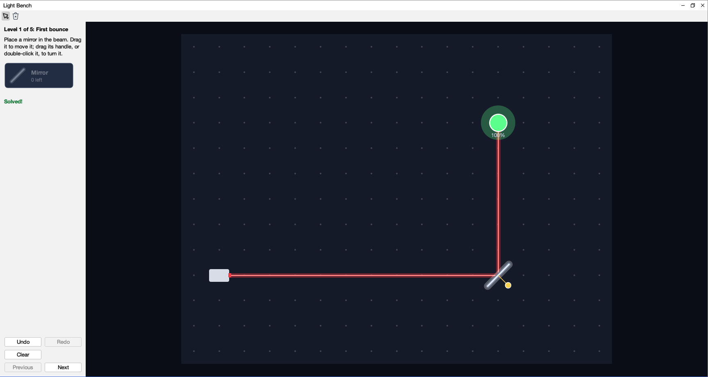

# Light Bench

A laser puzzle built on [MDI](https://github.com/heddle/mdi). Steer the beam
onto every detector with mirrors, beam splitters and lenses.



## Run the prebuilt download

[Download the latest runnable ZIP](https://github.com/heddle/mdi-optics/releases/latest/download/mdi-optics-runnable.zip) · [Release notes](https://github.com/heddle/mdi-optics/releases/latest).

These links work once the first version is released.

With Java 17 or newer installed, extract the entire ZIP, open a terminal in the
extracted folder, and run:

```bash
java -jar mdi-optics.jar
```

Keep the bundled `lib` folder next to the JAR. No Maven build is required.

Before publication, the release workflow smoke-tests the runnable ZIP on Linux, Windows, Intel macOS, and Apple Silicon macOS with Java 17, launching it without Maven.

## Build from source

You need Java 17 or later and Maven.

```bash
mvn compile exec:java
```

## Play

- Click a piece in the palette, then click a grid point to put it there.
- Drag a piece to move it.
- Double-click a piece to turn it one step (22.5°), or select it and drag the
  yellow handle.
- Select a piece and press Delete to take it back.
- Undo and redo with the buttons or Cmd/Ctrl+Z and Cmd/Ctrl+Shift+Z. **Clear**
  removes every piece and can be undone.

| Piece | What it does |
| --- | --- |
| Mirror | Reflects the whole beam. |
| Splitter | Reflects half and lets half through. |
| Converging lens | Brings parallel rays together one focal length beyond it. |
| Diverging lens | Spreads parallel rays as if from one focal length behind it. |

Every piece works from either side. Walls, detectors and the laser stop the
beam. The number under a detector is the share of the laser's power it needs. A
detector with cross hairs is small, so rays must pass close to its center.

Levels 1 to 5 use mirrors and splitters. In levels 6 to 9 the laser sends three
parallel rays, which lenses can focus or spread. Select a lens to see its focal
points. You can move between levels freely, and each needs every piece you are
given.

The lenses are ideal thin lenses. Turning one makes it focus farther along a
beam that meets it at an angle, which gives some levels a second solution.

## How it is put together

| Package | Contents |
| --- | --- |
| `edu.cnu.mdi.optics.model` | Levels and the ray tracer. No Swing. |
| `edu.cnu.mdi.optics.view` | The board, the pieces and the palette. |

MDI supplies the window, the selecting and dragging of pieces, undo and redo,
and the drawn palette buttons (`DrawnToggleButton`). The items on the board are
the only record of the player's moves: the beam, the lit targets and the pieces
left are worked out from them.

## Add a level

Add `src/main/resources/levels/level-10.json` (and so on, without gaps):

```json
{
  "name": "My level",
  "hint": "Shown beside the board.",
  "laser": { "x": 1, "y": 3, "heading": 90 },
  "targets": [ { "x": 12, "y": 9, "power": 1.0 } ],
  "walls": [ { "x": 6, "y": 6, "heading": 90, "length": 4 } ],
  "mirrors": 1,
  "splitters": 0,
  "converging": 0,
  "diverging": 0,
  "focalLength": 4
}
```

The board runs from (0, 0) at the bottom left to (16, 12). Headings are degrees
clockwise from up. A wall runs at right angles to its heading. Optional settings:

- `"rays": 3` in `laser` sends three parallel rays, a third of a square apart,
  each with a third of the power.
- `"radius"` in a target makes it smaller than the usual 0.35.
- `focalLength`, in squares, applies to every lens in the level. It is 4 if
  left out.

The tests require a known solution for each level, in
`src/test/java/edu/cnu/mdi/optics/model/Solutions.java` (spoilers), and check by
exhaustive search that no level can be solved with fewer pieces than it hands
out. That search grows quickly with the number of pieces.

## Test

```bash
mvn verify
```

A further check opens the game and plays it with mouse events. It needs a
display, and writes screenshots to `target/`:

```bash
mvn test-compile exec:java -Dexec.mainClass=edu.cnu.mdi.optics.view.DesktopSmoke -Dexec.classpathScope=test
```

## Release

The release workflow (`.github/workflows/release-build.yml`) builds the runnable
ZIP, plays it with the mouse on Linux, Windows, Intel macOS and Apple Silicon
macOS, publishes a GitHub release only if all four pass, and then checks that
the links above resolve to it.

**Rehearse** it without publishing anything, on the current `main`:

```bash
gh workflow run release-build.yml --repo heddle/mdi-optics --ref main
```

**Release** version X.Y.Z:

1. Set the version in `pom.xml` to `X.Y.Z`, date the entry in `CHANGELOG.md`,
   and commit on `main`. Before the first release, also remove "These links work
   once the first version is released." above.
2. Create an annotated tag `vX.Y.Z` and push `main` and the tag. Pushing the tag
   publishes.

If a release fails before publication, push the fix to `main` and rerun it for
the existing tag:

```bash
gh workflow run release-build.yml --repo heddle/mdi-optics --ref main -f release-tag=vX.Y.Z
```

The rerun builds the tagged code with the desktop check from `main`. The two
macOS jobs pin Java 17.0.12 and retry once if the app stalls while starting, as
`mdi-chaos` does.

To build and check the ZIP on your own machine (this opens the game on screen):

```bash
bash scripts/build-runnable.sh
```

```bash
bash scripts/smoke-test-zip.sh target/mdi-optics-0.1.0-SNAPSHOT-runnable.zip
```

The check in `scripts/ReleaseDesktopSmoke.java` plays levels 1 and 6 and counts
nine levels, so update it when levels are added or reordered.

## License

[MIT](LICENSE). The ZIP includes the licenses of the libraries it bundles; the
ones the libraries do not carry themselves are in `docs/runtime-licenses`, so
update them when dependencies change.
